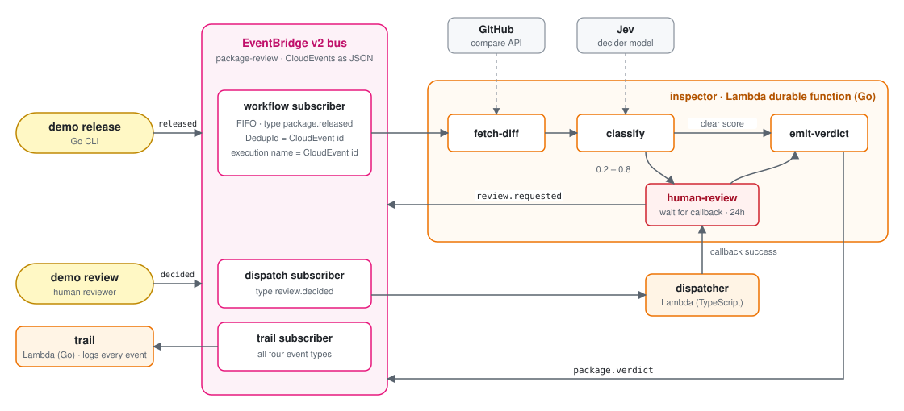

# EventBridge v2, durable functions and CloudEvents

This demo reviews package releases with the
[relaunched](https://aws.amazon.com/about-aws/whats-new/2026/09/eventbridge-relaunches-custom-event-buses/)
EventBridge custom event bus (EventBridge v2), Lambda
[durable functions](https://docs.aws.amazon.com/lambda/latest/dg/durable-functions.html) and
[CloudEvents](https://cloudevents.io/). A decider model scores each release diff, and a human
reviewer settles the uncertain cases. Each release runs as exactly one workflow execution, even when
the producer retries or the bus delivers an event twice. The durable functions use the Go
[SDK](https://github.com/aws/aws-durable-execution-sdk-go), which is in preview.

# The flow

A CLI announces a release as a CloudEvent. A durable workflow fetches the GitHub diff between the
two release tags and asks [Jev](https://typesafe.ai) how suspicious it looks. Jev is a decider model
that answers a yes-or-no question with a score from 0 to 1, and open decider models such as
[Ollaya](https://ollaya.dev/) fit the same slot. A score of 0.8 or more blocks the release,
and a score of 0.2 or less approves it. Anything in between waits up to 24 hours for a human
reviewer, who answers with the same CLI. The workflow publishes the verdict back onto the bus.

<p align="center"></p>

Subscribers pass events through unchanged (`RAW`), take one event per invocation, and are
configured with a dead-letter queue, retry policy and delivery logs. The workflow subscriber is
FIFO, but it invokes the inspector asynchronously, so ordering ends at Lambda's async queue. Each
release is its own execution, so the workflow doesn't depend on that order.

The inspector calls the real GitHub compare API with `Accept: application/vnd.github.diff`. It
rejects malformed repository and tag strings before any request, and treats 404 and 422 as a
missing release, which blocks it. Other errors retry. The classifier sees at most the first 64 KiB
of the diff. Unit tests replace GitHub, with a local HTTP server and a fake fetcher.

# Exactly-once, end to end

The bus alone gives exactly-once ingestion, and delivery to regular (non-durable) Lambda functions
remains at-least-once. The demo closes that gap with one id. The CloudEvent id of a release is the
workflow id (`DurableExecutionName` invocation parameter), and every layer deduplicates on it.

| Layer | Mechanism | A repeat of the same release |
|---|---|---|
| Ingestion | `DeduplicationId` = CloudEvent id | the bus returns `DEDUPLICATED` within 5 minutes |
| Delivery | `DurableExecutionName` = CloudEvent id | Lambda maps it onto the existing execution |
| Processing | durable steps checkpoint their results | a replay of completed steps calls neither GitHub nor Jev again |

A producer that retries only has to reuse the id and send the same payload. Events the workflow
emits derive their ids from the release id or the callback id, so their retries deduplicate at the
bus as well. To ensure reliable execution of durable steps in workflows, the default at-least-once
step semantics with retries are used. In rare cases when the downstream service in a step is retried
and does not support idempotent API calls, this can lead to duplicate step executions.

# Events

Events are structured CloudEvents 1.0 published as `application/json` (until the bus supports
`application/cloudevents+json`). The Lambda function Go handlers take a `ce.Event` from the
CloudEvents Go SDK directly.

| `type` | producer | data |
|---|---|---|
| `dev.example.package.released` | CLI | `ecosystem, name, repo, fromTag, toTag` |
| `dev.example.review.requested` | workflow | `callbackId, package, score, diffUrl, reason` |
| `dev.example.review.decided` | CLI | `callbackId, decision, reason, reviewer` |
| `dev.example.package.verdict` | workflow | `verdict, score, decidedBy, reason` |

# Setup

You need Go 1.26, Node 24, `brew install awscli aws-cdk`, and an AWS account with a CDK bootstrap
in a region that offers both the EventBridge v2 bus and durable functions. The stack deploys to the
region of your AWS profile or `AWS_REGION`, and falls back to `eu-central-1`.

```bash
make test
make deploy
```

The deploy writes the stack outputs to `infra/cdk-outputs.json`, and the CLI reads the bus ARN from
there, so run it from the repository root. It also takes the region from that ARN. `make synth`
without credentials needs `CDK_DEFAULT_ACCOUNT=111122223333` set.

# Walkthrough

The `left-pad` release scores 0 and is approved without a review. `--dup` publishes it twice. The
first line prints `PUBLISHED` and the second `DEDUPLICATED`.

```bash
go run ./cmd/demo release --dup npm/left-pad stevemao/left-pad v1.2.0 v1.3.0
```

Note that after 5 minutes the bus accepts the same id again. However, the function still lists one
execution for it due to the longer retention period for durable executions and execution-level
idempotency used in this demo.

```bash
go run ./cmd/demo release --id <ce_id> npm/left-pad stevemao/left-pad v1.2.0 v1.3.0
aws lambda list-durable-executions-by-function --function-name <InspectorFunctionName> \
  --durable-execution-name <ce_id>
```

The `dotenv` release scores 0.3 and waits for a reviewer. Take the `callback_id` from the
`requesting human review` line in the inspector's log group, then submit a decision.

```bash
go run ./cmd/demo release npm/dotenv motdotla/dotenv v16.3.1 v16.3.2
go run ./cmd/demo review --package npm/dotenv --approve --reason "looked fine" <callbackId>
```

The dispatcher completes the callback, the workflow resumes, and the trail logs `package.verdict`.

This Logs Insights query over the inspector, dispatcher and trail log groups follows one package.

```
fields @timestamp, component, message, ce_type, verdict, decided_by, reason
| filter ce_subject = "npm/dotenv"
| sort @timestamp asc
```

Subscriber delivery records land in `/aws/vendedlogs/eventsv2/package-review/<subscriber>`.

# Jev and GitHub keys

The stack creates two secrets with the value `none`. That selects the offline heuristic classifier
and unauthenticated GitHub calls. GitHub allows 60 unauthenticated requests per hour per IP, and
Lambda shares its outbound addresses, so a token avoids 403s that end in a blocked release.

```bash
aws secretsmanager put-secret-value --secret-id <JevSecretArn> --secret-string <your-jev-key>
aws secretsmanager put-secret-value --secret-id <GitHubTokenSecretArn> --secret-string <token>
```

The inspector reads both secrets once per cold start, and the workflow invokes the alias `live`.
Publish a new version and move the alias to pick up a change.

```bash
aws lambda update-function-configuration --function-name <InspectorFunctionName> --description reload
aws lambda wait function-updated --function-name <InspectorFunctionName>
aws lambda publish-version --function-name <InspectorFunctionName>
aws lambda update-alias --function-name <InspectorFunctionName> --name live --function-version <version>
```

# Local tests

`go test ./internal/workflow` runs the durable workflow in memory with the SDK's `durabletest`
package. It covers approval, blocking, escalation and resume, rejection, review timeout and
classifier failure, with GitHub, the classifier and the bus replaced by fakes.

# Cleaning up

Deleting a durable function waits up to 1 hour for running executions, and an open review runs for
up to 24 hours. Stop running executions first.

```bash
aws lambda list-durable-executions-by-function --function-name <InspectorFunctionName> --statuses RUNNING
aws lambda stop-durable-execution --durable-execution-arn <DurableExecutionArn>
make destroy
```
